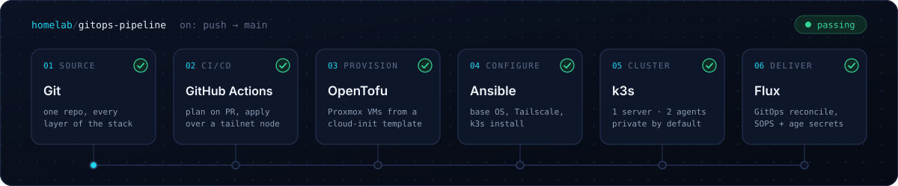

<div align="center">


<br />

<picture>
  <source media="(prefers-color-scheme: dark)" srcset="https://readme-typing-svg.demolab.com?font=JetBrains+Mono&weight=500&size=18&duration=2800&pause=1200&color=22D3EE&center=true&vCenter=true&width=620&height=40&lines=Infrastructure+as+code%2C+end+to+end;Proxmox+%E2%86%92+OpenTofu+%E2%86%92+Ansible+%E2%86%92+k3s+%E2%86%92+Flux;Peer-to-peer+compute+%40+UniCore;Knowledge+graphs+for+AI+agents+%40+ember;If+it+isn%27t+in+git%2C+it+doesn%27t+exist" />
  
</picture>

<br />

<a href="https://www.linkedin.com/in/jacobdeanpugh/"></a>
<a href="mailto:jacob.pugh.riverside@gmail.com"></a>

</div>

<br />

## `$ whoami`

```yaml
apiVersion: v1
kind: Engineer
metadata:
  name: jacob-pugh
  labels:
    school: california-baptist-university
    focus: infrastructure-and-automation
spec:
  currently:
    - ember        # capstone: the k3s cluster, GitOps and ingestion behind an MCP knowledge graph
    - homelab      # Proxmox → OpenTofu → Ansible → k3s → Flux, all of it in git
    - parallax     # where real-time object detectors fail, measured against a 10B VLA
  shipped:
    - unicore      # peer-to-peer compute marketplace, top contributor
  experience:
    - cbu-caimll   # Azure data pipelines, Salesforce (Apex + LWC)
  os: [arch, debian, rocky]   # arch to build, debian + rocky to run
  principles:
    - if it isn't in git, it doesn't exist
    - outbound-only networking, least privilege, encrypted secrets
    - automate it the second time
status:
  phase: Running
```

## `~/featured`

<table>
<tr>
<td width="50%" valign="top">

### [UniCore](https://github.com/ghbrando/unicore)

**Peer-to-peer compute marketplace.** Rent out idle CPU and RAM, or spin up a Linux VM from the browser with no cloud account. Provider machines are never exposed: their containers dial *out* to a GCP relay over FRP, so consumers get a browser SSH shell with zero open ports.

**What I built** · top contributor
- Persistent volumes, GCS sync and container snapshots
- Caddy wildcard-subdomain reverse proxy for VM services
- Provider dashboard backend, provider selection, emergency stop


</td>
<td width="50%" valign="top">

### [ember](https://github.com/cbu-capstone-design-27/ember)

**Graph-based context for AI coding agents.** Replaces static `AGENTS.md` files with a typed knowledge graph of a project's decisions, conventions, people and tickets, kept current from GitHub, Jira and Slack and served to any coding tool over MCP.

**What I built** · infrastructure
- The team's k3s cluster: nodes set up with Ansible, workloads deployed by Flux
- Tailscale Funnel and NGINX to receive GitHub webhooks
- CI that builds service images and publishes them to GHCR
- On-cluster Postgres, the ingestion architecture and the intake listener


</td>
</tr>
</table>

## `~/homelab`



A single-node Proxmox lab, defined end to end in code. OpenTofu builds the VMs, Ansible configures them, k3s runs the workloads and Flux keeps the cluster in sync with git. Nothing faces the internet: every machine is reachable only over a private Tailscale tailnet, and every secret is committed encrypted with SOPS + age. <sub>*Private repo, in progress.*</sub>

## `~/projects`

| Project | What it does | Built with |
| :-- | :-- | :-- |
| [**Graph-fil-A**](https://github.com/ghbrando/Graph-fil-A) | Speech in, interactive knowledge graph out. Five Cloud Run services fan out over Eventarc and Pub/Sub, Gemini extracts entities, and a Cytoscape mind map updates live. I deployed the API Gateway and built the multi-turn chat service. *Top contributor.* | GCP · Terraform · Gemini · React |
| **Parallax** 🔒 | Finds where real-time object detectors fail: scores stock YOLO and RT-DETR against a 10B reasoning model on street-level imagery, then clusters the disagreements into named failure modes. Runs on a DGX Spark. | Python · YOLO · RT-DETR · HDBSCAN |
| [**PughCV**](https://github.com/jacobdeanpugh/PughCV) | Tailors a résumé to a job description: an LLM returns a structured résumé and a containerized LaTeX toolchain renders the PDF. | Next.js · TypeScript · LaTeX · Docker |
| [**NoteHunt**](https://github.com/jacobdeanpugh/NoteHunt) | Watches note folders and keeps a Lucene full-text index in sync in real time, with file state tracked in embedded H2. | Java · Lucene · H2 |

## `~/contributions`

| Where | What I shipped |
| :-- | :-- |
| **CBU CAiMLL** 🔒 | Azure Data Factory pipelines and Python Azure Functions that crawl, download and clean source data, with unit tests. Salesforce work in Apex and Lightning Web Components. |
| **Dalcion** 🔒 | RAG pipeline plus document and code endpoints for an AI assistant that helps architects build within their company's codes; a fix to the Revit add-on. |
| [**Save-Water-CBU**](https://github.com/Save-Water-CBU) | Information security coursework: an [AES CLI](https://github.com/Save-Water-CBU/AES-Encryption) with PBKDF2 key derivation (Java 21) and a [simulated USB installer attack](https://github.com/Save-Water-CBU/USB-Crack-Attack) for classroom use (Python). |
| **ClassMates** 🔒 | A study-group app: groups, invites, friends, flashcards and account pages. |
| **Restaurant app template** 🔒 | Flutter: shopping cart, maps and theming for a reusable restaurant app. |

## `~/stack`

**Infrastructure & automation**<br />
<br />


**Cloud & data**<br />
<br />


**Languages & frameworks**<br />


<br />


